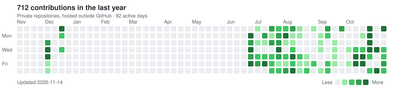

Hi, I'm Kevin.

Most of my work happens in private repositories outside GitHub, so it doesn't show in the GitHub graph further down. This is that activity:

<picture>
  <source media="(prefers-color-scheme: dark)" srcset="./activity-dark.svg">
  
</picture>
